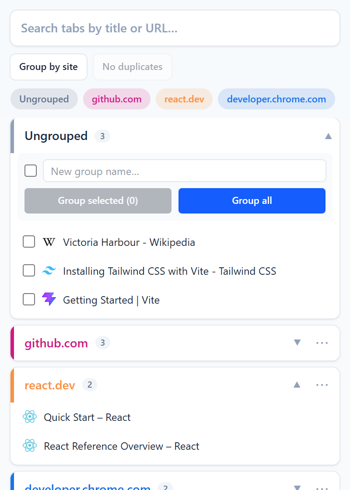
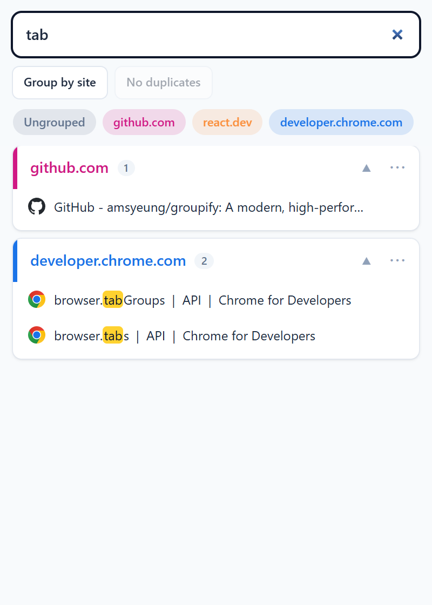
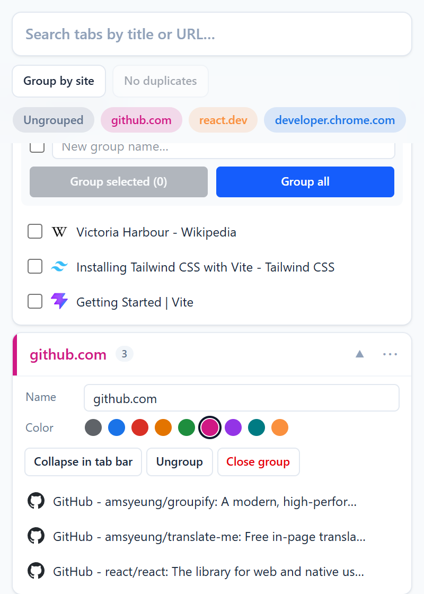

<div align="center">
  
  <h1>Groupify</h1>
  <p><strong>Find any tab in a second and keep your tab groups tidy, all from one popup.</strong></p>
  <a href="https://chromewebstore.google.com/detail/groupify/kkajifdljgkcniokopfhllcocblblmeh"></a>
  <a href="./LICENSE"></a>
  <p><a href="https://chromewebstore.google.com/detail/groupify/kkajifdljgkcniokopfhllcocblblmeh"><strong>➜ Add to Chrome — it's free</strong></a></p>
  
  
  
</div>

## Features

|                      |                                                                                                                   |
| -------------------- | ----------------------------------------------------------------------------------------------------------------- |
| **Search**           | Filter tabs by title or URL. <kbd>↑</kbd> <kbd>↓</kbd> and <kbd>Enter</kbd> jump to a tab, <kbd>Esc</kbd> clears. |
| **Group by site**    | One click puts ungrouped tabs from the same site into a group named after it.                                     |
| **Close duplicates** | Keeps one tab per page, with **Undo**.                                                                            |
| **Make groups**      | Tick tabs, name the group, done. New groups get a color that isn't taken.                                         |
| **Manage groups**    | The ⋯ menu renames, recolors, collapses, ungroups or closes a group.                                              |
| **Drag and drop**    | Drop a tab on a group, or on a shortcut at the top, to move it.                                                   |
| **Shortcut**         | <kbd>Alt</kbd>+<kbd>Shift</kbd>+<kbd>G</kbd> opens the popup (change it at `chrome://extensions/shortcuts`).      |

In English, 繁體中文 and 简体中文, in light and dark mode. More in the [FAQ](SUPPORT.md).

## Privacy

Groupify only reads the tabs open in your window. It stores nothing and sends nothing anywhere.

## Development

```bash
pnpm install
pnpm build   # extension in dist/, load it unpacked at chrome://extensions
pnpm test
```

Merging to `main` releases automatically, up to the Chrome Web Store: see [docs/PUBLISHING.md](docs/PUBLISHING.md).

## Support

[Open an issue](https://github.com/amsyeung/groupify/issues) or email [info@aoricreative.com](mailto:info@aoricreative.com).
