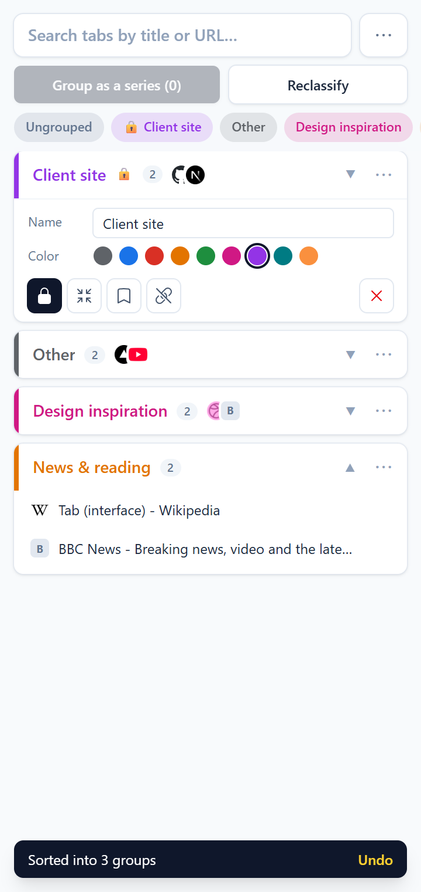
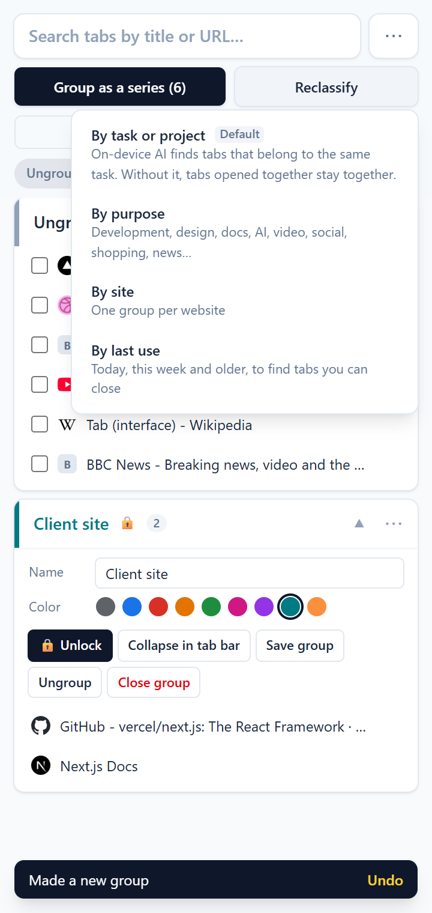
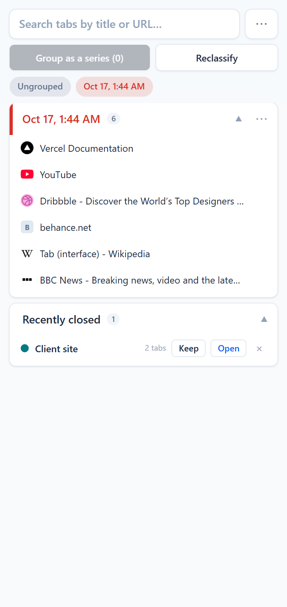
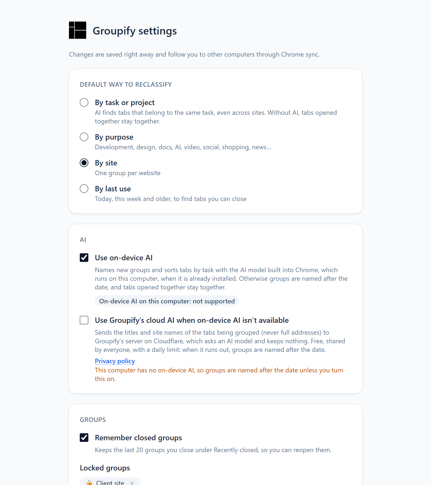

<div align="center">
  
  <h1>Groupify</h1>
  <p><strong>Keep your tabs sorted by what you're working on, from a side panel next to every page.</strong></p>
  <a href="https://chromewebstore.google.com/detail/groupify/kkajifdljgkcniokopfhllcocblblmeh"></a>
  <a href="./LICENSE"></a>
  <p><a href="https://chromewebstore.google.com/detail/groupify/kkajifdljgkcniokopfhllcocblblmeh"><strong>➜ Add to Chrome — it's free</strong></a></p>
  
  
  
</div>

## Features

|                              |                                                                                                                                                                                                                                       |
| ---------------------------- | ------------------------------------------------------------------------------------------------------------------------------------------------------------------------------------------------------------------------------------- |
| **Side panel**               | Click the toolbar icon (or press <kbd>Alt</kbd>+<kbd>Shift</kbd>+<kbd>G</kbd>) to keep Groupify open beside the page while you browse.                                                                                                |
| **Group as a series**        | One click puts every ungrouped tab into one new group, for whatever you're working on right now.                                                                                                                                      |
| **Reclassify**               | Sort every unlocked group again: by task or project, by purpose (development, design, docs, AI, video, social, shopping, news…), by site or by last use. **Undo** puts everything back.                                               |
| **Group by instruction**     | Type how you want your tabs grouped, like “work tabs together, YouTube and shopping apart”. Chrome's on-device AI does it with no limit; Groupify's free cloud AI, 3 times a day.                                                     |
| **Named for you**            | Chrome's on-device AI suggests names and finds tabs for the same task, privately on your computer. Without it, turn on Groupify's free cloud AI, or groups are named after the date.                                                  |
| **Your groups stay yours**   | Groups you name, rename or drag tabs into are locked automatically, and their sites are remembered, so Reclassify never pulls them apart. **Only tidy new tabs** puts new tabs into the groups they belong to and moves nothing else. |
| **Save, reopen and go back** | Save a group for later, reopen one you closed from **Recently closed**, go back any number of steps from **History**, or **Ungroup all** in one click.                                                                                |
| **Add to current group**     | New tabs join the group you're working in.                                                                                                                                                                                            |
| **Search**                   | Filter tabs by title or URL. <kbd>↑</kbd> <kbd>↓</kbd> and <kbd>Enter</kbd> jump to a tab, <kbd>Esc</kbd> clears.                                                                                                                     |
| **Tidy up**                  | Rename, recolor, collapse, ungroup or close a group from its icons, drag tabs between groups, and close duplicate tabs from the ⋯ menu.                                                                                               |
| **Settings**                 | The default way to reclassify, on-device or cloud AI, closed-group history, your locked groups and the shortcut.                                                                                                                      |

In English, 繁體中文 and 简体中文, in light and dark mode. More in the [FAQ](SUPPORT.md).

## Privacy

Groupify reads the tabs open in your window and keeps everything in your browser: settings, locked groups, the groups you save and the last 20 groups you closed. AI features use the model built into Chrome, on your computer. Cloud AI is off by default; only if you turn it on are the titles and site names of the tabs being grouped (never full addresses), and any instruction you type, sent to Groupify's AI server, which keeps nothing. Read the [privacy policy](https://groupify.aoricreative.com/privacy) and [how the AI server works](server/ai-proxy/README.md).

<p align="center"></p>

## Development

```bash
pnpm install
pnpm build   # extension in dist/, load it unpacked at chrome://extensions
pnpm test
```

Merging to `main` releases automatically, up to the Chrome Web Store: see [docs/PUBLISHING.md](docs/PUBLISHING.md). The optional cloud AI is a Cloudflare Worker in [`server/ai-proxy`](server/ai-proxy/README.md), deployed separately with Wrangler. The website and privacy policy at [groupify.aoricreative.com](https://groupify.aoricreative.com) are in [`website`](website/README.md), deployed the same way.

## Support

See the [FAQ](SUPPORT.md), [open an issue](https://github.com/amsyeung/groupify/issues) or email [info@aoricreative.com](mailto:info@aoricreative.com).
